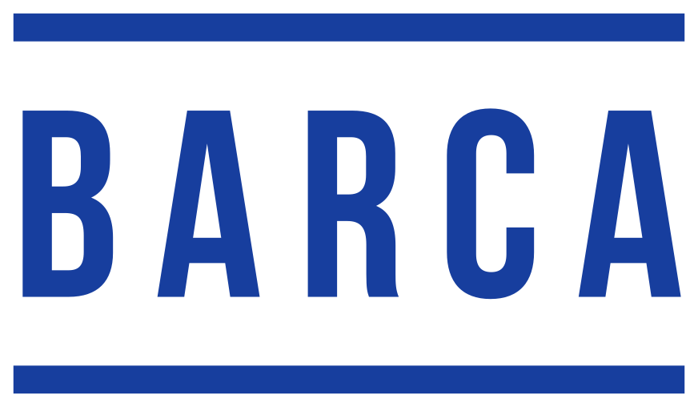
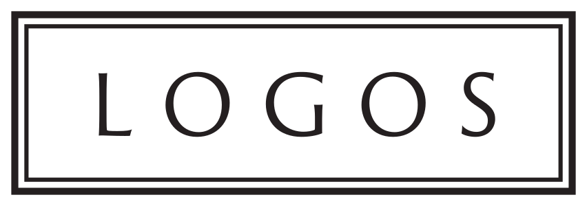
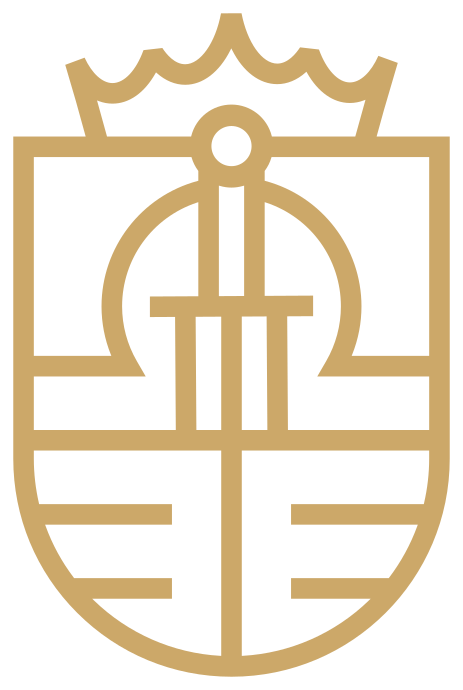
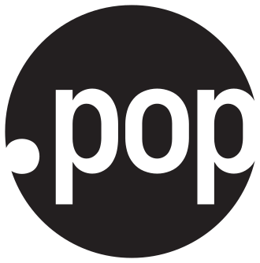
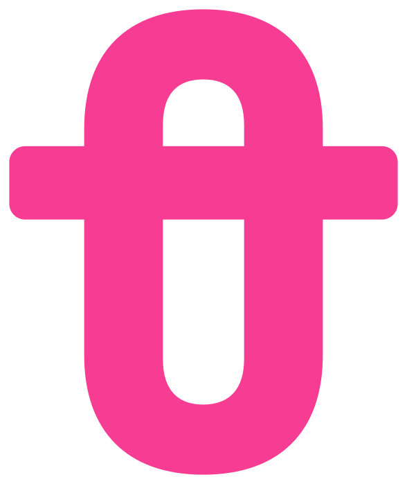
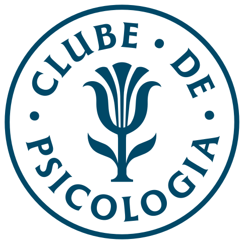
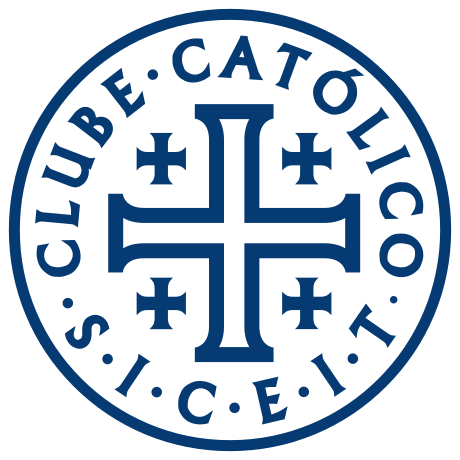
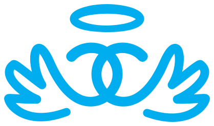
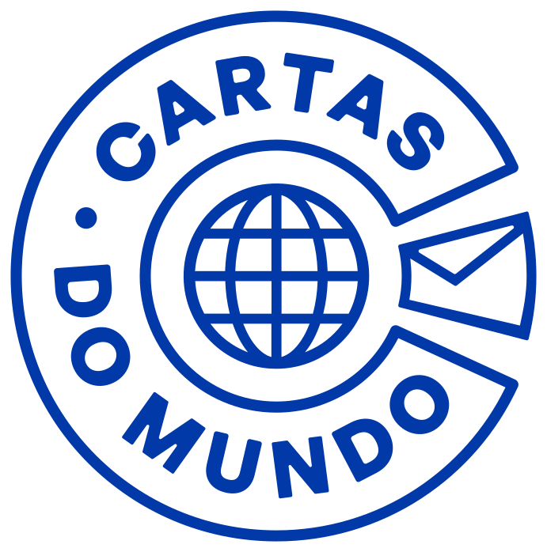
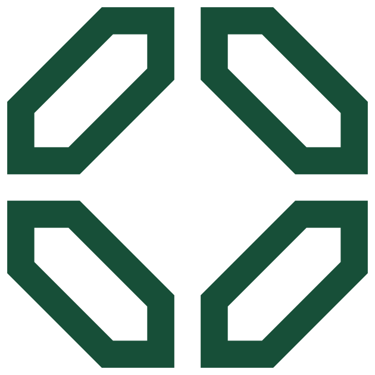

# Marcas BARCA

Logos oficiais, paleta e ícones dos 13 selos do ecossistema [BARCA](https://barca.cc). Paleta aprovada em 05/11/2026.

| Logo | Selo | Cores | Fontes (títulos / texto) | Baixar |
|---|---|---|---|---|
|  | **[BARCA](barca/GUIA.md)**<br><sub>Aceleradora de cultura · <i>Cultura, pesquisa e arte.</i></sub> | `#173E9E` `#FFFFFF` | Bebas Neue / Radio Canada Big | [SVG](https://raw.githubusercontent.com/geronimochagas-lang/barca-marcas/main/barca/svg/barca-simbolo-cor.svg) · [PNG](https://raw.githubusercontent.com/geronimochagas-lang/barca-marcas/main/barca/png/barca-simbolo-cor-2048.png) · [pasta](barca/) |
|  | **[Logos — Clube de Filosofia](logos/GUIA.md)**<br><sub>Filosofia · <i>A filosofia nasce do espanto.</i></sub> | `#FDBD00` `#C62D2C` `#241F20` `#FBF9F5` | Source Serif Pro / Source Sans 3 | [SVG](https://raw.githubusercontent.com/geronimochagas-lang/barca-marcas/main/logos/svg/logos-simbolo-cor.svg) · [PNG](https://raw.githubusercontent.com/geronimochagas-lang/barca-marcas/main/logos/png/logos-simbolo-cor-2048.png) · [pasta](logos/) |
|  | **[Círculo Jurídico](circulo-juridico/GUIA.md)**<br><sub>Direito · <i>Fazendo o Direito pensar de novo.</i></sub> | `#000042` `#CCA869` `#F9F0E5` | Marcellus / Merriweather Sans | [SVG](https://raw.githubusercontent.com/geronimochagas-lang/barca-marcas/main/circulo-juridico/svg/circulo-juridico-simbolo-cor.svg) · [PNG](https://raw.githubusercontent.com/geronimochagas-lang/barca-marcas/main/circulo-juridico/png/circulo-juridico-simbolo-cor-2048.png) · [pasta](circulo-juridico/) |
|  | **[Realpolitik](realpolitik/GUIA.md)**<br><sub>Política · <i>A política como ela é.</i></sub> | `#000000` `#FFFFFF` `#F6F2E9` | EB Garamond / Archivo | [SVG](https://raw.githubusercontent.com/geronimochagas-lang/barca-marcas/main/realpolitik/svg/realpolitik-simbolo-cor.svg) · [PNG](https://raw.githubusercontent.com/geronimochagas-lang/barca-marcas/main/realpolitik/png/realpolitik-simbolo-cor-2048.png) · [pasta](realpolitik/) |
|  | **[Biblioteca.pop](biblioteca-pop/GUIA.md)**<br><sub>Livros pocket · <i>Grandes livros no seu bolso.</i></sub> | `#D74B2C` `#231F20` `#FFFFFF` | Supreme / Iosevka | [SVG](https://raw.githubusercontent.com/geronimochagas-lang/barca-marcas/main/biblioteca-pop/svg/biblioteca-pop-simbolo-cor.svg) · [PNG](https://raw.githubusercontent.com/geronimochagas-lang/barca-marcas/main/biblioteca-pop/png/biblioteca-pop-simbolo-cor-2048.png) · [pasta](biblioteca-pop/) |
|  | **[Pessôa Editora](pessoa/GUIA.md)**<br><sub>Literatura contemporânea · <i>A nova casa da literatura.</i></sub> | `#F73C93` `#0B0B0B` `#E0D0BC` | Barlow / Work Sans | [SVG](https://raw.githubusercontent.com/geronimochagas-lang/barca-marcas/main/pessoa/svg/pessoa-simbolo-cor.svg) · [PNG](https://raw.githubusercontent.com/geronimochagas-lang/barca-marcas/main/pessoa/png/pessoa-simbolo-cor-2048.png) · [pasta](pessoa/) |
|  | **[Clube de Psicologia](psicologia/GUIA.md)**<br><sub>Psicologia · <i>A biblioteca essencial da mente.</i></sub> | `#004867` `#BA584A` `#ECE5D8` | Crimson Pro / DM Sans | [SVG](https://raw.githubusercontent.com/geronimochagas-lang/barca-marcas/main/psicologia/svg/psicologia-simbolo-cor.svg) · [PNG](https://raw.githubusercontent.com/geronimochagas-lang/barca-marcas/main/psicologia/png/psicologia-simbolo-cor-2048.png) · [pasta](psicologia/) |
|  | **[Clube Católico](clube-catolico/GUIA.md)**<br><sub>Catolicismo · <i>Para quem ama a verdade.</i></sub> | `#053B72` `#F3EEDA` `#C5A059` | Faculty Glyphic / Work Sans | [SVG](https://raw.githubusercontent.com/geronimochagas-lang/barca-marcas/main/clube-catolico/svg/clube-catolico-simbolo-cor.svg) · [PNG](https://raw.githubusercontent.com/geronimochagas-lang/barca-marcas/main/clube-catolico/png/clube-catolico-simbolo-cor-2048.png) · [pasta](clube-catolico/) |
|  | **[Clubinho Católico](clubinho-catolico/GUIA.md)**<br><sub>Catolicismo infantil · <i>Livros para seu filho crescer na fé.</i></sub> | `#00AEEF` `#FEF9C6` `#FE934E` | Averia Serif Libre / Albert Sans | [SVG](https://raw.githubusercontent.com/geronimochagas-lang/barca-marcas/main/clubinho-catolico/svg/clubinho-catolico-simbolo-cor.svg) · [PNG](https://raw.githubusercontent.com/geronimochagas-lang/barca-marcas/main/clubinho-catolico/png/clubinho-catolico-simbolo-cor-2048.png) · [pasta](clubinho-catolico/) |
|  | **[Barquinha Literária](barquinha/GUIA.md)**<br><sub>Literatura infantil · <i>Embarque no mundo da leitura.</i></sub> | `#0137A4` `#01AE9A` `#FCF2E8` | Lilita One / Outfit | [SVG](https://raw.githubusercontent.com/geronimochagas-lang/barca-marcas/main/barquinha/svg/barquinha-simbolo-cor.svg) · [PNG](https://raw.githubusercontent.com/geronimochagas-lang/barca-marcas/main/barquinha/png/barquinha-simbolo-cor-2048.png) · [pasta](barquinha/) |
|  | **[Cartas do Mundo](cartas-do-mundo/GUIA.md)**<br><sub>Cartas de viagem · <i>Cada envelope, uma viagem.</i></sub> | `#0139A9` `#F2EEDA` `#FFCF69` | General Sans / Parkinsans | [SVG](https://raw.githubusercontent.com/geronimochagas-lang/barca-marcas/main/cartas-do-mundo/svg/cartas-do-mundo-simbolo-cor.svg) · [PNG](https://raw.githubusercontent.com/geronimochagas-lang/barca-marcas/main/cartas-do-mundo/png/cartas-do-mundo-simbolo-cor-2048.png) · [pasta](cartas-do-mundo/) |
|  | **[Clube Capital](clube-capital/GUIA.md)**<br><sub>Negócios · <i>De cabeça no mundo dos negócios.</i></sub> | `#174F38` `#E7F2F0` `#D4AF37` | Instrument Sans / Bebas Neue | [SVG](https://raw.githubusercontent.com/geronimochagas-lang/barca-marcas/main/clube-capital/svg/clube-capital-simbolo-cor.svg) · [PNG](https://raw.githubusercontent.com/geronimochagas-lang/barca-marcas/main/clube-capital/png/clube-capital-simbolo-cor-2048.png) · [pasta](clube-capital/) |
|  | **[Timeless Book Club](timeless/GUIA.md)**<br><sub>Clássicos em inglês · <i>Build the library that outlasts you.</i></sub> | `#111111` `#F5F2EB` `#DBBE8C` | Adelon / Source Sans 3 | [SVG](https://raw.githubusercontent.com/geronimochagas-lang/barca-marcas/main/timeless/svg/timeless-simbolo-cor.svg) · [PNG](https://raw.githubusercontent.com/geronimochagas-lang/barca-marcas/main/timeless/png/timeless-simbolo-cor-2048.png) · [pasta](timeless/) |

## O que tem em cada pasta

```
<selo>/
  GUIA.md            cores (HEX/RGB/CMYK), fontes, respiro, tamanho mínimo, não-fazer
  svg/               <slug>-simbolo-cor.svg (oficial) · -black · -white · -mono-<hex> · -square · -favicon · -app-icon
                     lockups (quando existem): -horizontal / -vertical / -circular / -empilhado / -selo
                     -simbolo-pequeno.svg: corte para menos de 48 px (Psicologia, Clube Católico, Cartas do Mundo)
  png/               as mesmas versões em PNG transparente: 512 e 2048 px (lockups: 1200 e 3000 px)
  web/               favicon.ico, favicon.svg, apple-touch-icon.png, icon-192/512.png, maskable-512.png,
                     site.webmanifest, head-snippet.html (colar no <head> do site)
  teste-de-uso.html  folha de testes: tamanhos, 16/32 px, fundos, uma cor
```

## Link direto para qualquer arquivo

```
https://raw.githubusercontent.com/geronimochagas-lang/barca-marcas/main/<slug>/svg/<slug>-simbolo-cor.svg
https://raw.githubusercontent.com/geronimochagas-lang/barca-marcas/main/<slug>/png/<slug>-simbolo-cor-2048.png
```

Slugs: `barca`, `logos`, `circulo-juridico`, `realpolitik`, `biblioteca-pop`, `pessoa`, `psicologia`, `clube-catolico`, `clubinho-catolico`, `barquinha`, `cartas-do-mundo`, `clube-capital`, `timeless`.
Tudo em formato de dados: [`marcas.json`](marcas.json).

## Regras rápidas
- Não distorcer, girar, recolorir fora da paleta, nem aplicar sombra, contorno, degradê ou brilho metálico. Dourados são cor impressa, sem foil.
- Respiro mínimo de ¼ da altura do símbolo. Selos circulares com texto pedem 48 px no mínimo; abaixo disso use o corte pequeno.
- CMYK dos guias é aproximado: valide com a gráfica. Só a BARCA tem Pantone definido (Reflex Blue C).

## Pendências
- Timeless: lockups "TIMELESS BOOKCLUB" ainda com fonte AdelonSerial como texto vivo (fora do kit).
- Pessôa: wordmark completo sem SVG (só PNG/.ai); o kit tem o monograma.

Gerado com a skill [logo-design](https://github.com/kaankiziltug/logo-design-skill) a partir das marcas existentes; nenhuma marca foi redesenhada. Marcas registradas dos respectivos selos BARCA.
