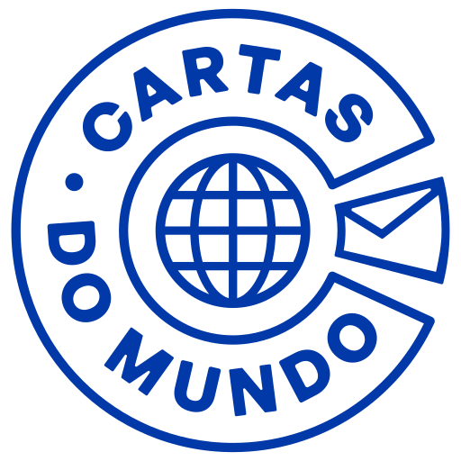

# Cartas do Mundo — Guia de uso da marca

> *Cada envelope, uma viagem.* · Cartas de viagem · [www.cartasdomundo.com.br](https://www.cartasdomundo.com.br)

## 1. A marca
Selo postal circular com globo e envelope. O texto do anel some abaixo de 48 px: abaixo disso use o corte pequeno (`cartas-do-mundo-simbolo-pequeno.svg`, só o globo).

- **Versões**: símbolo · corte pequeno
- **Master**: `svg/cartas-do-mundo-simbolo-cor.svg` (vetor limpo, sem fundo, recortado a partir de `Assets/logo-cartas.svg`)
- **Teste visual**: abra `teste-de-uso.html` no navegador (escada de tamanhos, teste de pixel 16/32 px, fundos, 1 cor, contextos)

## 2. Cores oficiais
| Nome | HEX | RGB | CMYK aprox. | Uso |
|---|---|---|---|---|
| Azul Postal | `#0139A9` | 1, 57, 169 | 99/66/0/34 | primária |
| Creme Envelope | `#F2EEDA` | 242, 238, 218 | 0/2/10/5 | fundo |
| Amarelo Selo | `#FFCF69` | 255, 207, 105 | 0/19/59/0 | acento (site) |

> CMYK é conversão matemática aproximada — **validar com a gráfica** (e definir Pantone) antes de imprimir.

**Pares aprovados**: marca na cor oficial sobre branco/claro · marca `#FFFFFF` sobre `#0139A9` (é o app-icon) · preto sobre claro · branco sobre fundo escuro ou foto calma.

## 3. Tipografia de apoio
- **Títulos**: General Sans · **Texto**: Parkinsans
- Fonte: levantamento do site oficial em 2026-11-05. Não substituem a marca — nunca redigite o logotipo com elas.
- Capas e miolo seguem o projeto gráfico de cada livro (ver `PRODUCT_SPEC.md`).

## 4. Área de proteção e tamanho mínimo
- **Respiro**: em volta da marca, no mínimo **¼ da altura do símbolo** livre de texto, bordas ou imagens.
- **Mínimo na tela**: 48 px de altura para o selo completo; abaixo disso use o corte pequeno · **favicon**: `web/favicon.ico` / `favicon.svg`
- **Mínimo impresso**: 15 mm (selo completo) · 6 mm (corte pequeno)

## 5. Arquivos do kit
| Arquivo | Para quê |
|---|---|
| `svg/cartas-do-mundo-simbolo-app-icon.svg` | ícone de app (marca sobre a cor) |
| `svg/cartas-do-mundo-simbolo-black.svg` | preto 1 cor |
| `svg/cartas-do-mundo-simbolo-cor.svg` | cor oficial (master) |
| `svg/cartas-do-mundo-simbolo-favicon.svg` | favicon |
| `svg/cartas-do-mundo-simbolo-mono-0139a9.svg` | monocromático na cor #0139A9 |
| `svg/cartas-do-mundo-simbolo-pequeno.svg` | corte para tamanhos pequenos |
| `svg/cartas-do-mundo-simbolo-square.svg` | quadrado com respiro (avatar / redes) |
| `svg/cartas-do-mundo-simbolo-white.svg` | branco 1 cor (fundos escuros) |
| `png/*-512.png`, `png/*-2048.png` | mesmas versões em PNG transparente (lockups: 1200 e 3000 px de largura) |
| `web/` | `favicon.ico` (16/32/48), `favicon.svg`, `apple-touch-icon.png`, `icon-192/512.png`, `maskable-512.png`, `site.webmanifest`, `head-snippet.html` (colar no `<head>` do site) |

## 6. Não fazer
Não distorcer · não recolorir fora da paleta · não girar · não aplicar sombra, contorno, degradê ou brilho metálico (os acabamentos são impressos, sem foil — regra do cliente) · não reorganizar as partes do lockup · não aplicar sobre fundo poluído sem caixa de cor · não redigitar o nome com outra fonte.

## 7. Observações técnicas
Auditoria: 473 pontos e 13 arestas levemente fora de esquadro — esperado em selo com texto em anel; o corte pequeno resolve.

---
*Gerado em 2026-11-05 com a skill logo-design (kaankiziltug/logo-design-skill) a partir das marcas existentes — nenhuma marca foi redesenhada. Ver o [README](../README.md).*
