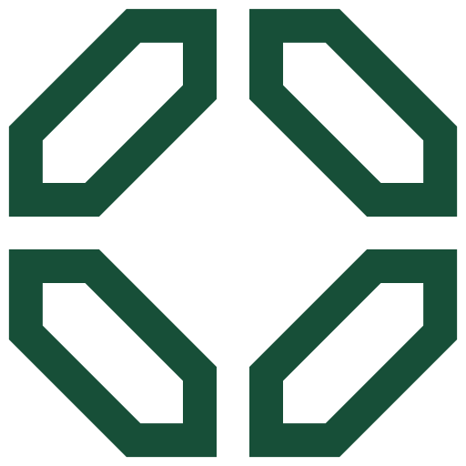

# Clube Capital — Guia de uso da marca

> *De cabeça no mundo dos negócios.* · Negócios · [clube.capital](https://clube.capital)

## 1. A marca
Quatro módulos chanfrados formando um "C" quadrado. Lockups horizontal, vertical e circular disponíveis.

- **Versões**: símbolo · lockups: horizontal, vertical, circular
- **Master**: `svg/clube-capital-simbolo-cor.svg` (vetor limpo, sem fundo, recortado a partir de `Assets/logo-capital.svg`)
- **Teste visual**: abra `teste-de-uso.html` no navegador (escada de tamanhos, teste de pixel 16/32 px, fundos, 1 cor, contextos)

## 2. Cores oficiais
| Nome | HEX | RGB | CMYK aprox. | Uso |
|---|---|---|---|---|
| Verde Capital | `#174F38` | 23, 79, 56 | 71/0/29/69 | primária |
| Menta | `#E7F2F0` | 231, 242, 240 | 5/0/1/5 | marca sobre o verde / fundo |
| Dourado Nobre | `#D4AF37` | 212, 175, 55 | 0/17/74/17 | acento impresso |

> CMYK é conversão matemática aproximada — **validar com a gráfica** (e definir Pantone) antes de imprimir.

**Pares aprovados**: marca na cor oficial sobre branco/claro · marca `#E7F2F0` sobre `#174F38` (é o app-icon) · preto sobre claro · branco sobre fundo escuro ou foto calma.

## 3. Tipografia de apoio
- **Títulos**: Instrument Sans · **Texto**: Bebas Neue
- Fonte: levantamento do site oficial em 2026-11-05. Não substituem a marca — nunca redigite o logotipo com elas.
- Capas e miolo seguem o projeto gráfico de cada livro (ver `PRODUCT_SPEC.md`).

## 4. Área de proteção e tamanho mínimo
- **Respiro**: em volta da marca, no mínimo **¼ da altura do símbolo** livre de texto, bordas ou imagens.
- **Mínimo na tela**: 24 px de altura · **favicon**: `web/favicon.ico` / `favicon.svg`
- **Mínimo impresso**: 10 mm de altura

## 5. Arquivos do kit
| Arquivo | Para quê |
|---|---|
| `svg/clube-capital-circular-black.svg` | preto 1 cor |
| `svg/clube-capital-circular-cor.svg` | cor oficial (master) |
| `svg/clube-capital-circular-mono-174f38.svg` | monocromático na cor #174F38 |
| `svg/clube-capital-circular-white.svg` | branco 1 cor (fundos escuros) |
| `svg/clube-capital-horizontal-black.svg` | preto 1 cor |
| `svg/clube-capital-horizontal-cor.svg` | cor oficial (master) |
| `svg/clube-capital-horizontal-mono-174f38.svg` | monocromático na cor #174F38 |
| `svg/clube-capital-horizontal-white.svg` | branco 1 cor (fundos escuros) |
| `svg/clube-capital-simbolo-app-icon.svg` | ícone de app (marca sobre a cor) |
| `svg/clube-capital-simbolo-black.svg` | preto 1 cor |
| `svg/clube-capital-simbolo-cor.svg` | cor oficial (master) |
| `svg/clube-capital-simbolo-favicon.svg` | favicon |
| `svg/clube-capital-simbolo-mono-174f38.svg` | monocromático na cor #174F38 |
| `svg/clube-capital-simbolo-square.svg` | quadrado com respiro (avatar / redes) |
| `svg/clube-capital-simbolo-white.svg` | branco 1 cor (fundos escuros) |
| `svg/clube-capital-vertical-black.svg` | preto 1 cor |
| `svg/clube-capital-vertical-cor.svg` | cor oficial (master) |
| `svg/clube-capital-vertical-mono-174f38.svg` | monocromático na cor #174F38 |
| `svg/clube-capital-vertical-white.svg` | branco 1 cor (fundos escuros) |
| `png/*-512.png`, `png/*-2048.png` | mesmas versões em PNG transparente (lockups: 1200 e 3000 px de largura) |
| `web/` | `favicon.ico` (16/32/48), `favicon.svg`, `apple-touch-icon.png`, `icon-192/512.png`, `maskable-512.png`, `site.webmanifest`, `head-snippet.html` (colar no `<head>` do site) |

## 6. Não fazer
Não distorcer · não recolorir fora da paleta · não girar · não aplicar sombra, contorno, degradê ou brilho metálico (os acabamentos são impressos, sem foil — regra do cliente) · não reorganizar as partes do lockup · não aplicar sobre fundo poluído sem caixa de cor · não redigitar o nome com outra fonte.

## 7. Observações técnicas
Auditoria da skill sem alertas relevantes.

---
*Gerado em 2026-11-05 com a skill logo-design (kaankiziltug/logo-design-skill) a partir das marcas existentes — nenhuma marca foi redesenhada. Ver o [README](../README.md).*
