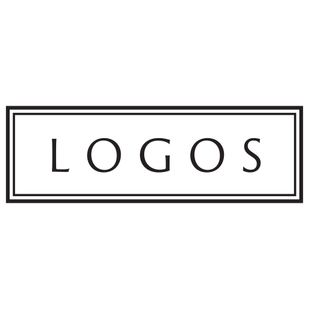

# Logos — Clube de Filosofia — Guia de uso da marca

> *A filosofia nasce do espanto.* · Filosofia · [clubedefilosofia.com](https://clubedefilosofia.com)

## 1. A marca
Wordmark espaçado em moldura dupla. Versão BR = marca preta sobre Dourado Solar; versão US = marca branca sobre Carmesim. A moldura fina some abaixo de ~120 px de largura: no digital pequeno use o app-icon.

- **Versões**: símbolo
- **Master**: `svg/logos-simbolo-cor.svg` (vetor limpo, sem fundo, recortado a partir de `Assets/logo-logos-br.svg`)
- **Teste visual**: abra `teste-de-uso.html` no navegador (escada de tamanhos, teste de pixel 16/32 px, fundos, 1 cor, contextos)

## 2. Cores oficiais
| Nome | HEX | RGB | CMYK aprox. | Uso |
|---|---|---|---|---|
| Dourado Solar | `#FDBD00` | 253, 189, 0 | 0/25/100/1 | primária (BR) |
| Carmesim Clássico | `#C62D2C` | 198, 45, 44 | 0/77/78/22 | primária (US) / secundária |
| Preto Ébano | `#241F20` | 36, 31, 32 | 0/14/11/86 | marca e texto |
| Branco Papiro | `#FBF9F5` | 251, 249, 245 | 0/1/2/2 | fundo |

> CMYK é conversão matemática aproximada — **validar com a gráfica** (e definir Pantone) antes de imprimir.

**Pares aprovados**: marca na cor oficial sobre branco/claro · marca `#241F20` sobre `#FDBD00` (é o app-icon) · preto sobre claro · branco sobre fundo escuro ou foto calma.

## 3. Tipografia de apoio
- **Títulos**: Source Serif Pro · **Texto**: Source Sans 3
- Fonte: levantamento do site oficial em 2026-11-05. Não substituem a marca — nunca redigite o logotipo com elas.
- Capas e miolo seguem o projeto gráfico de cada livro (ver `PRODUCT_SPEC.md`).

## 4. Área de proteção e tamanho mínimo
- **Respiro**: em volta da marca, no mínimo **¼ da altura do símbolo** livre de texto, bordas ou imagens.
- **Mínimo na tela**: 24 px de altura · **favicon**: `web/favicon.ico` / `favicon.svg`
- **Mínimo impresso**: 10 mm de altura

## 5. Arquivos do kit
| Arquivo | Para quê |
|---|---|
| `svg/logos-simbolo-app-icon.svg` | ícone de app (marca sobre a cor) |
| `svg/logos-simbolo-black.svg` | preto 1 cor |
| `svg/logos-simbolo-cor.svg` | cor oficial (master) |
| `svg/logos-simbolo-favicon.svg` | favicon |
| `svg/logos-simbolo-mono-241f20.svg` | monocromático na cor #241F20 |
| `svg/logos-simbolo-mono-c62d2c.svg` | monocromático na cor #C62D2C |
| `svg/logos-simbolo-square.svg` | quadrado com respiro (avatar / redes) |
| `svg/logos-simbolo-white.svg` | branco 1 cor (fundos escuros) |
| `png/*-512.png`, `png/*-2048.png` | mesmas versões em PNG transparente (lockups: 1200 e 3000 px de largura) |
| `web/` | `favicon.ico` (16/32/48), `favicon.svg`, `apple-touch-icon.png`, `icon-192/512.png`, `maskable-512.png`, `site.webmanifest`, `head-snippet.html` (colar no `<head>` do site) |

## 6. Não fazer
Não distorcer · não recolorir fora da paleta · não girar · não aplicar sombra, contorno, degradê ou brilho metálico (os acabamentos são impressos, sem foil — regra do cliente) · não reorganizar as partes do lockup · não aplicar sobre fundo poluído sem caixa de cor · não redigitar o nome com outra fonte.

## 7. Observações técnicas
Auditoria da skill sem alertas relevantes.

---
*Gerado em 2026-11-05 com a skill logo-design (kaankiziltug/logo-design-skill) a partir das marcas existentes — nenhuma marca foi redesenhada. Ver o [README](../README.md).*
